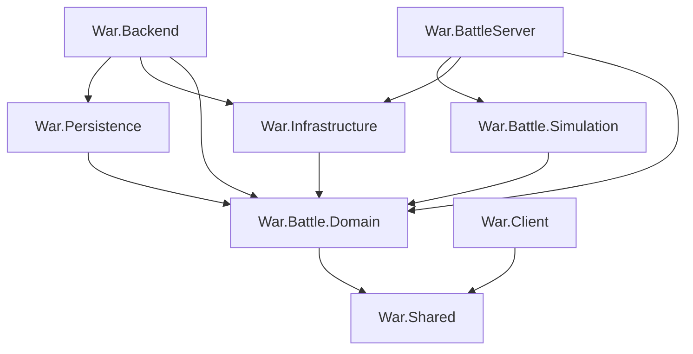

# Server battle project boundaries

The Backend and battle Worker now share a server-only Domain library. The Worker runs a separate
Simulation library. Backend has no reference to either the Worker executable or mutable simulation;
Persistence references Domain/Shared only. Compiled assembly checks guard these boundaries.

## Runtime dependencies



Backend, Worker, Simulation, Persistence and Infrastructure also reference Shared directly. Domain
and Simulation use the ordinary .NET SDK. Neither references ASP.NET, MongoDB, a signer or a host.
Domain references only Shared; Simulation references Domain/Shared. Portable Client/Shared reference
no server library. Verification consoles intentionally reference hosts to test actual handlers;
they are not deployed server dependencies.

## Ownership

| Project | Responsibility | Authored C# files |
| --- | --- | ---: |
| War.Backend | HTTP, compatibility actions and persistence coordination | 173 |
| War.BattleServer | UDP/session routing, local journals and Backend adapters | 59 |
| War.Battle.Domain | Shared server contracts, source content and managed rules/geometry | 306 |
| War.Battle.Simulation | Mutable combat state, objectives, evidence and native adapters | 610 |

Hosts contain only Program.cs at their C# roots; libraries keep implementation in feature folders.
Public namespaces remain unchanged, including War.BattleServer and the queue identity's
War.Infrastructure namespace. Wire names, protobuf fields, DTO member order and source identities
are preserved. Rebuild and deploy server binary sets together; mixing newly built DLLs into an old
deployment is unsupported.

Domain content loaders still read trusted deployment JSON and embedded source evidence. Domain
independence does not imply that every method is free of file I/O or that C12/C13 are complete.

### Domain folders

- Matches and Matchmaking own manifests, allocator loadout rules, queue identities and admission policy.
- Content/Packages owns BattleCombatContent and its revision manifest.
- Content/Army, Weapons, Air, Vehicles, Players, Coop, Grenades and Mortars own source definitions,
  bindings, upgrade rows and pose/reference data.
- Content/Maps, Barrels, Shields and Geometry own source geometry and managed spatial calculations.
- Combat/Projectiles owns flight definitions, ballistics and the existing rocket speed bound. It
  constructs no mutable BulletFlight or native physics lease.
- Cards, Presentation and Results retain card identities, pose validation, terminal validation and
  read-only statistic projections.

### Simulation folders

Match keeps the existing MatchEngine partial family together. Coop keeps the existing co-op runtime
family. Weapons, Projectiles, Army, Air, Vehicles, Cards and World own match-local execution and state.
Timing owns observed source clocks; Objectives and Events own progress and event production.
Results/Progression own local ledgers and handoff; Physics owns native imports and leases.
IMatchRuntime is the Worker-facing runtime port.

Existing cohesive internal helpers remain grouped. Public top-level types split during relocation
have separate files. The new assembly does not split shared MatchEngine/CoopMatchRuntime state:
S07/S08/S09 still own those systems, update order and narrower ports.

## Content and runtime seams

Six catalogs formerly constructed mutable projectile flights. Their Prepare methods now live in
Simulation factories. WeaponStageSelection pairs a source ID with its admitted zero-based index;
BulletLaunch names the host projectile, owner, muzzle, target, tick, roll and collision query.
Both are value types. Factory methods accept at most four parameters, including their receiver,
and preserve source critical multipliers, damage coefficients, shot offsets and validation.

RifleMatchSimulation draws its single-bullet roll only inside the selected weapon branch. Shotguns
keep their own per-pellet random sequence. Grouping inputs adds no reference context allocation per
shot; it does not establish a measured throughput or network-latency improvement.

GrenadeBallistics preserves operation order, 9.81 gravity and the 0.2 target-height offset.
GrenadeFlight retains a forwarding method. RocketProjectilePolicy owns the existing 100-speed host
bound; the flight's former constant remains an alias. These are not new balance values.

HelicopterAircraftPosePolicy validates the existing bounded position/unit rotation without native
physics. Both source loading and the native adapter use it. Initial joint data and managed
construction stay in Domain; mutable worlds, handles and stepping stay in Simulation.

MissionCatalog stays in Domain. MissionRuntimeFactory's objective/spawn extensions stay in Simulation.
The MainScene provenance mismatch remains V07; extraction changes no catalog digest or Client asset.

## Terminal recovery and signing

BattleTerminalEvidenceValidator owns canonical payload/digest and complete snapshot validation.
It performs no file/socket/database work. Backend, Persistence and projections call it directly.
TerminalOutbox and ActiveMatchJournal remain in the Worker and own durable local recovery.
The existing outbox validation wrapper delegates to Domain; Simulation owns neither journal.

Keys, MAC derivation and token parsing stay outside both rule libraries. Queue signing remains in
Infrastructure; match signing remains in Worker transport. The 300-second queue policy has one
Domain owner and the signer constant remains an alias. Portable SDK assemblies carry no server keys.
Infrastructure owns TransportSecurityPolicy, BattleControlKeyPolicy, immutable BattleKeyMaterial,
DeploymentValueParser and BattleEndpointPolicy. It also owns TerminalResultEnvelope,
BoundedStreamReader and ControlRequestAuthenticator. Both hosts use shared deployment/transport
rules; Simulation retains no key policy. Compiled assertions guard these shared owners.

## Embedded resources

| Logical resource | Owner / loader |
| --- | --- |
| War.BattleServer.OrdinaryCardIdentities | Domain / OrdinaryCardIdentityCatalog |
| War.BattleServer.GrenadeRig | Domain / GrenadeRigCatalog |
| War.BattleServer.GrenadierCornerMuzzles | Simulation / GrenadierCornerMuzzleCatalog |
| War.BattleServer.GrenadierPrimaryWeapon | Simulation / GrenadierPrimaryWeapon |

Resources keep their source-pinned bytes and names and move with their loaders. Worker embeds no
duplicate. The host still carries its PhysX notice. Native provisioning and actual Linux/Unity
execution remain distinct deployment/gameplay gates.

## Move evidence and verification

[server-source-layout.json](server-source-layout.json) retains all 687 original root moves.
[battle-project-extraction.json](battle-project-extraction.json) records 632 origins and 915 unique
destinations. Hashes describe pre-extraction source, not a permanent content freeze. Three initially
partial origins now record both their Domain types and remaining Simulation implementation.

The second phase processes 600 sources into 235 additional Domain files and 610 Simulation files.
An exact declaration comparison verified all 1,021 moved/split type parts after seam extraction.
Moved sources use LF; namespace and declaration bodies were retained by the move. Explicit factory
and managed-policy changes are described above.

```powershell
python Server/tools/verify_server_source_layout.py
python Server/tools/test_server_source_layout.py
python Server/scripts/verify_battle_checkpoint.py --suite focused --case battle-projects --no-build
```

The --battle-projects-only selector checks 65 compiled ownership, dependency, resource, portable-SDK
and native-import assertions. --battle-domain-only remains an alias. Fast/runtime/source checkpoints
use the broader project check. Layout guards verify exact inventory and clean host/library roots.
Runtime, native/legacy and fresh publish results are recorded in [TESTING.md](TESTING.md).

S05 gives both hosts composition/transport owners; S06 retains legacy dispatch. Worker control and
terminal envelope boundaries are described in WORKER_HOST_STRUCTURE.md and TERMINAL_HTTP_ENVELOPE.md.
C12/C13/C18, V07, measured performance, Linux
deployment and normal Unity/Android gameplay retain their own gates in
[todo-list.md](../../todo-list.md). Assembly extraction does not close those requirements.
