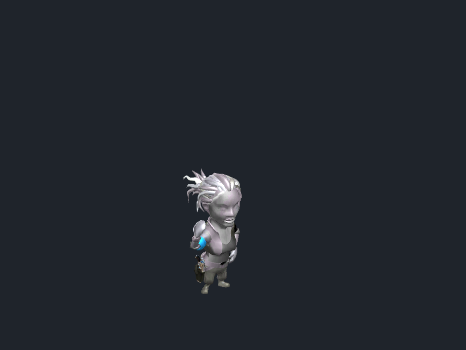

# Gunslinger weapon presentation

The script-free infantry presenter now selects the recovered Gunslinger weapon and applies the
host-owned `IsColtHolstered` roster field. This is a component integration, not proof that normal
battle controllers use the replacement transport or that a complete match is playable.

## Source rules

The current MainScene `UpgradeSlotsGunslicer` has one level-zero weapon definition in each of its
normal and Elite lanes. Both select model 25, `Weapons/Pistol_Gunslinger/gunslinger`. The resolver
validates that constant-model condition before using it. A future variable lane requires explicit
upgrade authority instead of silently selecting a default model.

`SoldierParts.SnapColt` and `FakeRigidBodySwapper` move the weapon's `snapPoint`, not its entire root.
The adapter maps the source hand and holster identities into the copied hierarchy before any
reparenting. Drawing disables the rigid copy, enables the hand object, and resets the snapPoint's
local position, rotation and scale. No recovered gameplay, Photon or physics component is activated.

The shared visual factory also follows `SpawningManager` by restoring root scale to one, and uses
`SkinnedMeshTools.ChangeSkins` for name-based bone binding while preserving destination materials.
Using template bone indexes or model-prefab materials produced incorrect rendering.

## Native evidence

The disposable Unity 2018.3.0f2 audit executes the current presenter and visual helpers against the
recovered MainScene and weapon assets. The published fixture binds their source and asset hashes.

- Four normal/Elite threshold selections agree with the original weapon-level resolver.
- Twelve draw/holster/draw comparisons agree with inherited original `Swap` and `SnapTo` methods.
- Four production presenter checks apply protobuf-decoded rows, verify holster and draw transitions,
  and remove the actor when its roster entry disappears.
- The copied actors contain no `MonoBehaviour` components.

The reference subclass suppresses only editor construction callbacks until serialized fields have
been assigned; the attachment methods under comparison remain inherited from the original class.

```powershell
python -B Server/tools/verify_gunslinger_weapon_presenter.py --check
```




These are native camera captures. Body progression, team textures and complete cosmetic rendering
are not established by these base-material images. Every animation frame, moving-target blends,
normal battle-controller wiring, full active Client compilation/Play Mode, Android, Linux runtime
and original Unity 5.2.5 parity remain outside this audit. See the
[feature checklist](BATTLE_SERVER_FEATURES.md) for the remaining BattleServer work.
